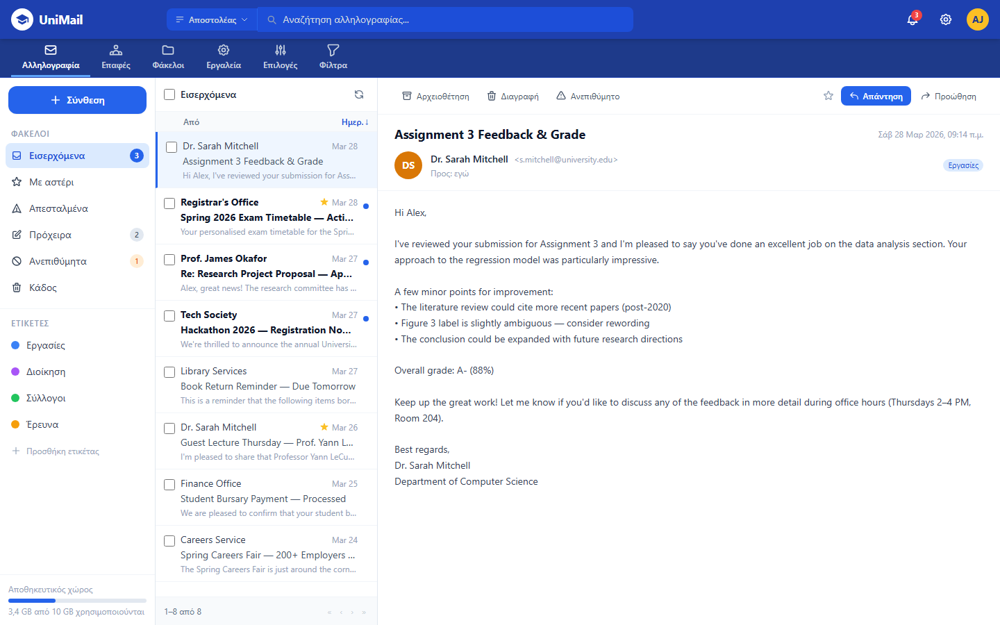
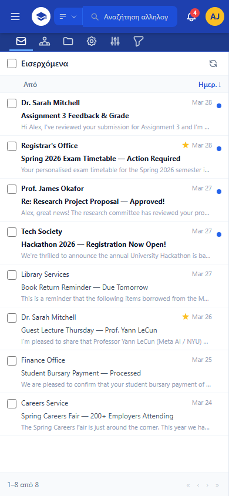
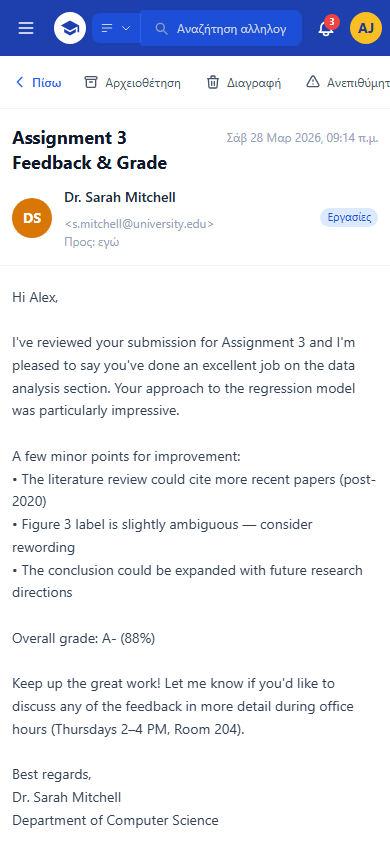

# UniMail

A modern, student-friendly redesign of a university webmail client.

UniMail is a front-end prototype that reimagines the legacy SquirrelMail-based webmail used at my university. The goal was **full feature parity** with the old system: every page and action it offers is present here, redesigned to be cleaner, faster to use and mobile-friendly. The interface is in Greek, like the original platform.

> **Note:** This is a UI/UX prototype. It runs entirely in the browser on mock data. There is no mail server or backend, so nothing is actually sent or stored.

**Live demo:** https://&lt;your-username&gt;.github.io/unimail/



<p align="center">
  
  &nbsp;&nbsp;
  
</p>

## Features

**Mail**
- Three-pane layout: folders, message list, and an inline reading pane (no page reloads)
- Sortable message list with pagination and adjustable page size
- Bulk selection: mark read/unread, delete, or mark as spam
- Star, archive, delete and mark-as-spam actions
- Search by sender, subject, body, To, CC, or everywhere
- Unread badges and a notifications panel

**Compose**
- Floating compose window that doesn't interrupt reading
- To / CC / BCC (BCC hidden by default)
- Save draft, discard, minimise

**Management pages**
- **Contacts:** personal address book with full contact details, add/edit/delete, CSV import/export
- **Folders:** create, rename and delete folders; subscribe to shared folders
- **Filters:** plain-language rule builder ("if From contains X → move to Y"), enable/disable rules
- **Tools:** directory lookup, POP3 fetch and password change (mocked)
- **Settings:** personal info, signature, display, junk folder and folder preferences

**UX**
- Responsive: sidebar and reading pane become slide-in panels on phones
- Toast feedback for every action
- Confirmation before destructive actions

## Tech stack

- HTML5 + vanilla JavaScript (no frameworks)
- [Tailwind CSS](https://tailwindcss.com/) via CDN
- A single self-contained `index.html` with no build step

## Running locally

No installation needed. Clone the repo and open `index.html` in a browser:

```bash
git clone https://github.com/<your-username>/unimail.git
cd unimail
start index.html      # Windows
open index.html       # macOS
```

## Project structure

```
unimail/
├── index.html   # the entire app: markup, styles and scripts
└── docs/        # screenshots used in this README
```

## Possible next steps

- Connect to a real IMAP/SMTP backend
- Split the single file into modules once the app has a build step
- Persist settings, contacts and filters (e.g. in `localStorage`)
